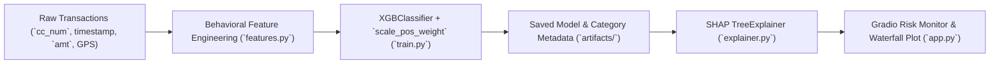

# Credit Card Fraud Risk Engine with Explainable AI (XAI)

Real-time behavioral fraud detection pipeline built with **Python**, **Pandas**, **XGBoost**, **SHAP**, and **Gradio** — engineered to detect anomalous card-swipe bursts under extreme `<1%` class imbalance while providing per-transaction SHAP waterfall explanations.

---

## Architecture & Feature Pipeline



### Behavioral, Temporal & Geospatial Features (`src/fraud_risk_engine/features.py`)

| Feature | Signal Captured |
| :--- | :--- |
| `Seconds_Since_Last_Txn` | Inter-swipe delta per card to detect non-human bot velocity bursts |
| `Txn_Velocity_24h` | Rolling 24-hour transaction count per cardholder |
| `Total_Spent_24h` | Rolling 24-hour cumulative spend drain per cardholder |
| `Transaction_Hour` | Temporal anomaly exposure (late-night fraud windows) |
| `Distance_to_Merchant` | Euclidean geospatial jump distance between cardholder and merchant |
| `amt` / `category_code` | Monetary spend and deterministic encoded merchant category |

---

## Model Design & Evaluation Highlights

On imbalanced Kaggle credit card fraud data (`kartik2112/fraud-detection`, 200k-row training subset where fraud represents `<1%` of samples):
* **Class Imbalance Handling:** Computed dynamic `scale_pos_weight` (`120.58`) inside `XGBClassifier` (`max_depth=7`, `learning_rate=0.05`, `subsample=0.8`, `colsample_bytree=0.8`) instead of naive oversampling.
* **Precision–Recall Tradeoff:** Prioritized **Recall (92%)**, **Precision (76%)**, and **F1-Score (83%)** to minimize missed fraud losses while keeping false flags manageable.
* **Explainability:** Integrated `shap.TreeExplainer` waterfall charts in real time to surface which behavioral features drove every `TRANSACTION BLOCKED` (`>65%` risk score) or `TRANSACTION APPROVED` decision.

*(For offline runs without Kaggle credentials, a realistic synthetic imbalanced transaction generator is built in so the entire train $\rightarrow$ evaluate $\rightarrow$ SHAP $\rightarrow$ Gradio pipeline can be verified locally out of the box.)*

---

## Local Setup & Quickstart

### 1. Create Virtual Environment & Install Dependencies
```bash
python -m venv .venv

# Windows PowerShell
.\.venv\Scripts\Activate.ps1

# Linux / macOS
source .venv/bin/activate

pip install -r requirements.txt
pip install -e . --no-build-isolation --no-deps
```

### 2. Train Model
```bash
# Train on Kaggle CSV (recommended for full dataset)
python -m fraud_risk_engine.train --dataset path/to/fraudTrain.csv --max-rows 200000

# Or run with built-in synthetic imbalanced transactions (no external files needed)
python -m fraud_risk_engine.train --synthetic-rows 8000
```

### 3. Launch Gradio Explainable Risk Dashboard
```bash
python -m fraud_risk_engine.app
```

### 4. Run Automated Tests
```bash
python -m unittest discover -s tests -v
```
